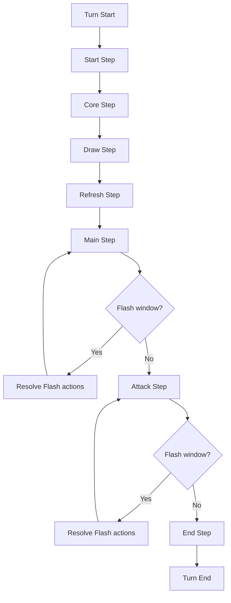

# バトルスピリッツ ルール調査レポート（開発手順書作成向け）

## エグゼクティブサマリ

本レポートは、指定ドメイン **batspi.com** のみを情報源として、バトルスピリッツのルールを「実装・仕様化（開発手順書作成）」の観点で整理したものです。batspi.com は“情報wiki”として運営されており、公式サイト（別ドメイン）への参照を含みますが、今回は**batspi.com 内で確認できる記述**に限定して抽出しています。citeturn26view0

調査対象の具体的項目（ユーザー指定）として、以下を明記し、それぞれ「仕様に落とせる形」でまとめます。  
（1）基本用語と定義（カード種類、ゾーン、コスト、効果タイプ、優先度など）  
（2）ターン構成と各フェイズの処理手順（開始→メイン→バトル→終了等、トリガーと割り込みの扱い）  
（3）カード効果の解決順と優先ルール、例外ケースの一覧  
（4）主要なキーワード能力とその実装上の注意点（継続効果、即時効果、誘発効果など）  
（5）ルール上の判定フローとエラーハンドリング（不整合時の処理）  
（6）テストケースとユースケース（代表的な複雑局面を複数提示）  
（7）開発手順書向けの要件定義、データモデル（カードデータ項目一覧）、API設計、UI/UX、優先度付き実装タスク

重要な前提として、batspi.com のナビゲーション上に存在する「基本ルール」「ターンの流れ」「用語集」「ルールQ&A」等の一部ページが、閲覧時点（2026-03-19 JST）では本文ではなく「編集」画面として表示され、本文を確認できないものがありました（＝batspi.com 内で“正式本文”が未確認）。citeturn28view0turn28view1turn28view2turn32view3  
そのため、本レポートでは **確認できた一次情報（カードタイプ定義ページ、カード効果（カテゴリ）ページ、待機状態・消滅などのルール解説ページ）** を軸に、足りない点は明示的に **「未指定」** として扱います。

## 調査範囲とソース評価

batspi.com は「公式ルール本文の一次掲載サイト」ではなく、カード情報・裁定・各種まとめを扱う wiki として自己定義しています。citeturn26view0  
一方で、ルール改定の根拠として「ルールマニュアルVer.11.0にあわせたルール改定（公式サイト）」等へのリンクを含むため、**“公式に基づく説明”を二次的に整理している部分**も存在します（ただし本件ではリンク先を追えない）。citeturn48view0turn29view0

| original_text | source | note |
|---|---|---|
| 〝トレーディングカードゲーム『バトルスピリッツ』の情報wikiです〟 | `https://batspi.com/` citeturn26view0 | batspi.com自体は“公式ルール本文”ではなく情報共有 wiki。よって、実装仕様化では「どの記述が公式由来か」「wiki独自整理か」を区別して記録するのが安全。 |
| 〝興味を持ったらまずは公式ページへ。〟 | `https://batspi.com/` citeturn26view0 | 公式参照の推奨が明記されているため、本レポートは「batspi.com内で確認できる範囲の仕様抽出」と位置づける。 |
| 〝待機状態とは、2020年5月のルールマニュアルVer.11.0にあわせたルール改定より追加〟 | `https://batspi.com/index.php?%E3%82%AB%E3%83%BC%E3%83%89%E5%8A%B9%E6%9E%9C%EF%BC%9A%E3%83%95%E3%82%A3%E3%83%BC%E3%83%AB%E3%83%89%E3%82%92%E9%9B%A2%E3%82%8C%E3%82%8B%E3%81%A8%E3%81%8D&word=CB25-074` citeturn48view0 | “公式ルールマニュアル改定”を根拠としている旨が本文中で明示されている（ただしリンク先は別ドメイン）。 |
| 〝【基本ルール=】の編集〟 | `https://batspi.com/index.php?%E5%9F%BA%E6%9C%AC%E3%83%AB%E3%83%BC%E3%83%AB=` citeturn28view0 | 「基本ルール」本文が batspi.com 上で確認できないため、基本手順のうち“明文化の所在”が不明な点は「未指定」扱いにする。 |

## 基本用語と定義

### カード種類（カテゴリ）定義

batspi.com では、主要カードタイプとして **スピリット／ブレイヴ／アルティメット／ネクサス／マジック** の概説が、それぞれページ内で説明されています。citeturn51view3turn50view0turn51view1turn51view2turn50view2  
開発手順書向けには、これらを「行動可能性（召喚・配置・使用）」「主戦力（攻防・バトル関与）」「ゾーン遷移（フィールド↔手札↔トラッシュ等）」で整理するのが実務的です。

| original_text | source | note |
|---|---|---|
| 〝すべての基礎となるカードタイプ〟 | `https://batspi.com/index.php?%E3%82%B9%E3%83%94%E3%83%AA%E3%83%83%E3%83%88&word=BS53-052` citeturn51view3 | **スピリット**は攻防・バトルの中心。ゲーム上、最頻出の状態遷移と効果対象になりやすいので、ルールエンジンの中心クラスに置く。 |
| 〝ブレイヴとは…4種類目のカードタイプ〟 | `https://batspi.com/index.php?%E3%83%96%E3%83%AC%E3%82%A4%E3%83%B4&word=SD57-005` citeturn50view0turn50view1 | **ブレイヴ**は召喚してフィールドに出すだけでなく、「合体」等の基本動作を持つ。実装では「装備/付与オブジェクト」ではなく**独立カード＋アタッチ状態**として表現した方が後工程（分離・交換・破壊）に強い。 |
| 〝カードフレーム…金色…第5のカードカテゴリ〟 | `https://batspi.com/index.php?%E3%82%A2%E3%83%AB%E3%83%86%E3%82%A3%E3%83%A1%E3%83%83%E3%83%88&word=BS24-068` citeturn51view1 | **アルティメット**はカテゴリとして独立。カード表示差（フレーム・シンボル表現）があるため UI/表示仕様に反映が必要。 |
| 〝フィールドにコストを支払って「配置」〟 | `https://batspi.com/?%E3%83%8D%E3%82%AF%E3%82%B5%E3%82%B9&word=BS21-071` citeturn51view2 | **ネクサス**は“召喚”ではなく“配置”が基本語彙として用いられている。行動タイプ（Summon vs Deploy）をアクション種別で区別するとログ設計が明瞭。 |
| 〝使い捨てカード…メイン/フラッシュ…どちらかの効果を選んで発揮〟 | `https://batspi.com/index.php?%E3%83%9E%E3%82%B8%E3%83%83%E3%82%AF&word=BS16-073` citeturn50view2 | **マジック**は“選択して発揮”が明記。実装では「同一カードの複数モード（Main/Flash）」を持つコマンドとして扱うのが自然。 |

### ゾーン・状態（フィールド、手札、デッキ、トラッシュ等）

ゾーンの語彙として、ブレイヴの説明内で「スピリット（フィールド上の呼称）」「スピリットカード（手札・デッキ・トラッシュに存在する時）」という、**ゾーン依存の呼称規則**が明示されています。citeturn50view0  
また、マジック使用手順では最終的な行き先として **トラッシュ**が明記されています。citeturn51view0

| original_text | source | note |
|---|---|---|
| 〝スピリットとはフィールド、スピリットカードとは手札・デッキ・トラッシュ…〟 | `https://batspi.com/index.php?%E3%83%96%E3%83%AC%E3%82%A4%E3%83%B4&word=SD57-005` citeturn50view0 | **同一カードでも所在ゾーンで“名称カテゴリ”が変わる**前提。開発では `cardType`（印刷種別）と `zoneRoleName`（ゾーン上の呼称）を混同しない。 |
| 〝カードをトラッシュに〟 | `https://batspi.com/index.php?%E3%83%9E%E3%82%B8%E3%83%83%E3%82%AF&word=BS16-073` citeturn51view0 | マジックの標準ゾーン遷移（使用後→トラッシュ）が手順として定義されている。例外（手札に戻る等）があるカードも存在しうるため、実装では“デフォルト遷移＋カード例外”で設計。 |
| 〝ボイドからコア3個を…創界神ネクサスに置く〟 | `https://batspi.com/index.php?%E3%82%AB%E3%83%BC%E3%83%89%E5%8A%B9%E6%9E%9C%EF%BC%9A%E3%83%95%E3%82%A3%E3%83%BC%E3%83%AB%E3%83%89%E3%82%92%E9%9B%A2%E3%82%8C%E3%82%8B%E3%81%A8%E3%81%8D&word=CB25-074` citeturn48view0 | **ボイド**と**コア配置先**（リザーブ/特定カード等）の概念が本文・カードテキストで前提化。コアは独立リソースとして管理。 |

### コスト・軽減・支払い

batspi.com 内で「マジック使用手順」の中に、**軽減の適用・コスト支払い**が手順として明記されています。citeturn51view0  
一方で、軽減の算出規則（例えば“シンボルによる軽減”の一般則）をまとめた「基本ルール」本文は未確認のため、軽減計算の詳細は本レポートでは **未指定** とします。citeturn28view0turn51view0

| original_text | source | note |
|---|---|---|
| 〝軽減の適用とコストの支払い〟 | `https://batspi.com/index.php?%E3%83%9E%E3%82%B8%E3%83%83%E3%82%AF&word=BS16-073` citeturn51view0 | 行動処理の中で、軽減→支払いが“対象選択より前”に置かれている。UI・APIはこの順序を前提に入力ステップを分割すると齟齬が減る。 |
| 〝【基本ルール=】の編集〟 | `https://batspi.com/index.php?%E5%9F%BA%E6%9C%AC%E3%83%AB%E3%83%BC%E3%83%AB=` citeturn28view0 | 軽減の一般則（どのシンボルがどの程度軽減するか等）は batspi.com 内の“基本ルール本文”として確認できず、本レポートでは未指定。 |

## ターン構成と各フェイズの処理手順

### ターン／ステップの骨格

batspi.com の検索結果上では「ターンの流れ」ページに、コアステップ・ドローステップ等の基本処理が記述されている旨が示されています。ただし、同ページは閲覧時点で本文が確認できず（編集画面表示）、確定的な引用としては **検索結果に現れた文言の範囲**に留めます。citeturn39search0turn28view1  
そのため、ここでは「“ステップ名”と“batspi.com上で確認できた処理手がかり”」を整理し、未確認部分は **未指定** とします。

| ステップ | batspi.com内で確認できた処理の手がかり | 実装メモ |
|---|---|---|
| スタートステップ | 未指定（本文未確認） | フック（開始時誘発）を持つ可能性が高いので、イベント名自体は用意する。 |
| コアステップ | 検索結果上に「ボイドからコアを1個…リザーブ」等の記述が示唆 | コア供給は“ターン処理の固定イベント”として実装（ただし細則は未指定）。citeturn39search0 |
| ドローステップ | 検索結果上に「ターンプレイヤー…ドロー」等の記述が示唆 | ドローは固定イベント。ドロー置換やドロー枚数変更はカード効果カテゴリが存在する。citeturn39search16 |
| リフレッシュステップ | 検索結果上に「回復とコアの移動」等が示唆 | 疲労/回復、リフレッシュ時の自動コア移動がある前提で状態更新イベントを用意。citeturn39search3 |
| メインステップ | マジックのメイン効果は「自分のメインステップでのみ使用可能」 | メイン効果の行動窓をここに固定。ブレイヴ基本動作も原則ここ。citeturn50view0turn50view2 |
| アタックステップ | 多数のカード効果が「自分のアタックステップ」「お互いのアタックステップ」等を参照 | “宣言→フラッシュ→ブロック→…“などの詳細は未指定だが、フラッシュタイミングが存在することは明示。citeturn50view2 |
| エンドステップ | 未指定（本文未確認） | 終了時誘発、ターン終了時の期限効果の解決などのイベント枠は必要。 |

### フラッシュタイミング（割り込み窓）の最低限仕様

マジックのフラッシュ効果は「自分のメインステップ」と「自分/相手のフラッシュタイミング」で使用できると明記されています。citeturn50view2turn51view0  
よって、実装上は **ステップ本体の処理と、割り込み窓（フラッシュ）を分離**しないと、ユーザー入力やログ再現が破綻します。

| original_text | source | note |
|---|---|---|
| 〝フラッシュ効果は 自分のメインステップと自分/相手のフラッシュタイミング のどちらでも使える〟 | `https://batspi.com/index.php?%E3%83%9E%E3%82%B8%E3%83%83%E3%82%AF&word=BS16-073` citeturn50view2 | フラッシュは“どのステップにも付随し得る割り込み窓”として扱う必要がある（少なくともメイン/アタックで発生）。 |

### ターン全体フローチャート（未指定部分を含む）

このフローチャートは「ステップ名の枠組み」と「batspi.comで確認できた行動窓（メイン効果、フラッシュ窓）」を反映し、処理の細則が未確認の箇所は“未指定”として空けています。citeturn39search0turn50view2turn28view1



## カード効果の解決順と優先ルール、例外ケース

### 効果解決の基本パイプライン（「使用」系）

batspi.com には、マジックについて **使用手順が番号付きで定義**されています。これを「カード使用系（マジック、手札から使用できる類似効果など）」の標準パイプラインとして採用し、他カテゴリにも拡張するのが、開発手順書として最も再利用性が高いです。citeturn51view0

| original_text | source | note |
|---|---|---|
| 〝使用の宣言とカードの提示〟 | `https://batspi.com/index.php?%E3%83%9E%E3%82%B8%E3%83%83%E3%82%AF&word=BS16-073` citeturn51view0 | UI/UXで「どのカードのどのモードを使うか」を先に確定し、ログにも残す。 |
| 〝軽減の適用とコストの支払い〟 | 同上 citeturn51view0 | “支払い前に対象選択できるか”はここで否定されている形。入力ステップは順序固定。 |
| 〝対象の選択…効果の発揮…誘発した派生効果の解決…カードをトラッシュに〟 | 同上 citeturn51view0 | 「派生効果」まで解決した後にゾーン移動（トラッシュ）という順序。実装では effectQueue を空にしてから `moveToTrash` を行う。 |

### 「待機状態」と「フィールドを離れるとき」効果

「フィールドを離れるとき」カテゴリページに、**待機状態**の定義が記述されています。待機状態は、破壊・消滅・バウンスなどでフィールド離脱が確定した“途中段階”として扱われ、種類ごとに待機状態が分かれるとされています。citeturn48view0  
このため、エンジン設計では「フィールド離脱」を単なる `move(field -> trash)` とせず、**必ず `enterPendingLeaveState(kind)` を経由**させる必要があります。

| original_text | source | note |
|---|---|---|
| 〝待機状態…破壊・消滅・バウンス…フィールドを離れることになった段階でのカードの状態〟 | `https://batspi.com/index.php?%E3%82%AB%E3%83%BC%E3%83%89%E5%8A%B9%E6%9E%9C%EF%BC%9A%E3%83%95%E3%82%A3%E3%83%BC%E3%83%AB%E3%83%89%E3%82%92%E9%9B%A2%E3%82%8C%E3%82%8B%E3%81%A8%E3%81%8D&word=CB25-074` citeturn48view0 | フィールド離脱を2段階化（離脱確定→待機→離脱完了）。このアーキテクチャが、後述の消滅処理・例外処理とも整合する。 |
| 〝一旦、破壊の待機状態・消滅の待機状態・バウンスの待機状態〟 | 同上 citeturn48view0 | `pendingLeaveKind ∈ {destroy, vanish, bounce}` をステートとして持つ。UIでも“破壊中/消滅中/バウンス中”を表示可能にする。 |

### 「消滅」の処理手順と例外

「消滅について」ページには、消滅の定義・待機状態で受け付ける効果の限定・効果喪失・トラッシュ移動タイミングなど、実装上の注意点が高密度に記載されています。citeturn29view0

特に重要なのは以下です。  
- 消滅は「コアが最低Lvコスト未満になった」状態を表す用語で、破壊とは別概念。citeturn29view0  
- 消滅待機状態では「フィールドを離れるとき」「消滅したとき」など、特定の効果だけを受け付ける。citeturn29view0  
- 消滅中は“消滅に関係ない効果が無効”になり、軽減シンボルにも使えない（破壊待機状態と差分）。citeturn29view0  
- “同時に発揮した効果が全て解決し終わった後”にトラッシュへ置かれる。citeturn29view0  
- **例外**として、コスト支払いにより消滅したカードは、元の効果の派生効果が終わるまでトラッシュに置かれない（＝ゾーン移動の遅延）。citeturn29view0  

| original_text | source | note |
|---|---|---|
| 〝コアが最低Lvコスト未満…表す用語〟 | `https://batspi.com/index.php?cmd=read&page=%E6%B6%88%E6%BB%85%E3%81%AB%E3%81%A4%E3%81%84%E3%81%A6&word=%E6%B6%88%E6%BB%85` citeturn29view0 | 消滅判定は「現在コア数」と「最低Lv要求」の比較で決まる“状態遷移”。状態ベースアクションとして常時監視対象。 |
| 〝消滅の待機状態では『フィールドを離れるとき、消滅したとき』効果しか受け付けず〟 | 同上 citeturn29view0 | pending状態の間は、ターゲット可否・効果適用可否を強制的に絞る必要がある（多くのバグ源）。 |
| 〝消滅…自…以外のすべての効果を失い…対象にならない〟 | 同上 citeturn29view0 | 実装では `effectiveAbilities = onlyVanishRelated` のように能力フィルタリングが必要。 |
| 〝同時に発揮した効果が全て解決し終わった後、トラッシュに置かれる〟 | 同上 citeturn29view0 | 解決キュー（同時誘発含む）を空にしてからゾーン移動する設計が必須。 |
| 〝コストの支払いで消滅…派生効果…終わるまではトラッシュに置かれない〟 | 同上 citeturn29view0 | **最重要例外**：コスト支払い由来の消滅は `deferMoveToTrashUntil(effectChainEnd)`。テストが必要（後述）。 |

## 主要なキーワード能力とその実装上の注意点

batspi.com には多数のキーワード能力ページが存在しますが、開発手順書の“最初の実装”では、まず **継続効果（常在）／使用型（手順あり）／誘発型（待機状態や離脱に結びつく）** の3分類で実装フレームを確立することが重要です。ここでは、batspi.com 内で**定義・手順が明示されている、またはカードテキストで具体的挙動を確認できる**ものを中心に扱います。

### 強化（チャージ）

強化は「常在型能力」であり、同じ記述の効果が重複適用されることや、最終数値にかかる色があることなどが説明されています。citeturn49view2  
これは実装上、「効果の対象・数値を決定する直前」に強化レイヤを挟む必要があることを意味します（固定値ではなく最終値に適用という記述）。citeturn49view2

| original_text | source | note |
|---|---|---|
| 〝すべてが…増幅・補助する常在型能力〟 | `https://batspi.com/?%E5%BC%B7%E5%8C%96&word=LM13-03` citeturn49view2 | 強化は“状態として常時ON”。バフをイベントとして積むのではなく、評価関数（計算）側で参照する方が一貫する。 |
| 〝同じ記述の効果が重複して適用〟 | 同上 citeturn49view2 | スタック可否が明記されているため、`stackingPolicy=additive` をデフォルトに。 |
| 〝実際に効果を解決する時の最終的な数値にかかる〟 | 同上 citeturn49view2 | “対象選択より後”かつ“解決直前”の評価が必要。途中でBP/コア数が変動し得るので、スナップショットのタイミングを仕様化する。 |

### マジック（使用型）と派生効果

マジックは「メイン/フラッシュのどちらか一方だけ」を使い、手順が定義されています。citeturn50view2turn51view0  
この“手順”は、他の「手札から使用できる効果」や「類似の使用型キーワード」にも横展開すると、UI/ログ/リプレイが揃いやすいです。

| original_text | source | note |
|---|---|---|
| 〝1枚のカードで使用できる効果はどちらか1つだけ〟 | `https://batspi.com/index.php?%E3%83%9E%E3%82%B8%E3%83%83%E3%82%AF&word=BS16-073` citeturn50view2 | 1カードに複数モードがあっても同時使用は不可。UIはモード選択を必須化。 |
| 〝マジックによって誘発した派生効果の解決〟 | 同上 citeturn51view0 | “派生効果”という概念が明示。エンジンは `effectChainId` を持ち、派生を同一チェーンで追跡できるとデバッグが容易。 |

### ソウルマジック（コスト支払いの特殊化）

カードテキスト例として、ソウルマジックは「赤シンボルがあればソウルコアだけで使用できる」と記述されています。citeturn50view3  
これはコスト支払いロジックに条件分岐が必要であることを示します。

| original_text | source | note |
|---|---|---|
| 〝自分の赤シンボルがあれば[ソウルコア]だけで使用できる〟 | `https://batspi.com/index.php?%E3%83%9E%E3%82%B8%E3%83%83%E3%82%AF&word=BS16-073` citeturn50view3 | 支払いソースが「通常コア」ではなく「ソウルコアのみ」に切り替わる条件。コスト支払いAPIは `allowedCoreSources` を返せる設計にする。 |

### ブレイヴの基本動作（合体・交換・分離）

ブレイヴは基本動作として「合体/交換/分離」を持ち、特別なテキストがない限りメインステップでしか行えないと記述されています。citeturn50view0  
これは“カードの種類”がそのまま“許可される標準アクション集合”を決める例であり、実装時に **カードカテゴリ→標準アクション許可** をテーブル化すると拡張しやすいです。

| original_text | source | note |
|---|---|---|
| 〝基本動作として合体/交換/分離…メインステップでしか…〟 | `https://batspi.com/index.php?%E3%83%96%E3%83%AC%E3%82%A4%E3%83%B4&word=SD57-005` citeturn50view0 | ルールエンジンの `legalActions(state)` は「カードタイプ＋現在ステップ」を入力に含める。 |

### 指定アタック系（ブロック制約との競合）

指定アタックのカテゴリページでは、「ブロックのルールに制約を増やす効果が働いている場合、相手スピリットを指定できない」と明記されています。citeturn43view1  
この種のルールは、UIで“指定候補が一瞬出てから消える”などの不整合が起きやすいため、**指定アタック可否をターゲット選択UIの前に判定**する必要があります。

| original_text | source | note |
|---|---|---|
| 〝…制約を増やす効果が働いている場合は相手スピリットを指定することはできない〟 | `https://batspi.com/index.php?%E3%82%AB%E3%83%BC%E3%83%89%E5%8A%B9%E6%9E%9C%EF%BC%9A%E6%8C%87%E5%AE%9A%E3%82%A2%E3%82%BF%E3%83%83%E3%82%AF&word=BSC18-X02` citeturn43view1 | 競合ルールを“例外”ではなく“前提条件”として扱う：`canDeclareDesignatedAttack = false` を返す。 |

## ルール上の判定フローとエラーハンドリング

ここでは、batspi.com に明示された「使用手順」「待機状態」「消滅処理」を“判定フロー（開発手順書に落とす形）”として再構成します。根拠は主に、マジック使用手順と待機状態定義、消滅処理手順です。citeturn51view0turn48view0turn29view0

### 判定フロー（推奨：ルールエンジンの標準テンプレ）

以下は、**(A) 使用型アクション**（マジック等）と、**(B) 状態ベース遷移**（消滅等）を統合したテンプレです。

```mermaid
flowchart TD
  S[Action requested] --> V1[Validate step/permissions]
  V1 --> V2[Validate cost payability]
  V2 --> P[Apply reductions & pay cost]
  P --> T[Select targets (if needed)]
  T --> R[Resolve primary effect]
  R --> D[Resolve derived/triggered effects until queue empty]
  D --> Z[Zone move / cleanup]
  Z --> SBA[State-based checks: pending leave, vanish, etc.]
  SBA --> END[Commit & log]
```

このテンプレの根拠となる“手順の順序”は、マジック使用手順の番号に対応します。citeturn51view0  
また、`State-based checks` の中核として「待機状態」の導入、および消滅待機状態で受け付ける効果限定が必要です。citeturn48view0turn29view0

### エラーハンドリング指針（実装上の扱い）

開発手順書向けに、エラーを「入力エラー」「ルール不成立」「内部不整合」に分類し、ユーザーへの提示とログの粒度を決めます。以下は batspi.com 記述から直接導ける範囲を中心に定義します。

| エラー種別 | 代表例 | 根拠（batspi.com上の手がかり） | UI/ログ上の推奨対応 |
|---|---|---|---|
| 入力エラー | 使用宣言していないのに対象選択しようとする | 使用手順が「宣言→支払い→対象選択」の順序で定義 citeturn51view0 | UIはウィザード型入力（前段未完了なら次へ進めない）。 |
| ルール不成立 | 指定アタック条件を満たすが、ブロック制約効果が有効で指定不可 | 指定アタックのページで“指定できない”と明記 citeturn43view1 | 事前に `canDeclare` を返し、操作候補に出さない。 |
| 状態遷移制約 | 消滅待機状態中のカードに、消滅関係以外の効果が当たろうとする | “対象にならない”“効果を失う”が明記 citeturn29view0 | ターゲティング時点で除外し、理由をツールチップ表示。 |
| 派生効果の順序問題 | コスト支払いで消滅したカードのトラッシュ移動が早すぎる | “派生効果…終わるまではトラッシュに置かれない” citeturn29view0 | effectChain終了まで遅延する内部フラグをログに残す。 |
| 内部不整合 | 本来本文参照すべきページが編集画面で本文未確認 | 基本ルール等が編集画面表示 citeturn28view0turn28view1 | 仕様書に「未指定」ラベルを残し、一次ソース差替えを前提にする。 |

## テストケースとユースケース（複雑局面）

ここでは、上記の“仕様として明文化できた部分”を中心に、再現性の高いテストケースを提示します。テストケースは「初期状態→操作→期待ログ/状態」の形で書き、実装のリグレッションに使えるようにします。

### マジック使用の標準手順テスト

**根拠**：マジック使用手順が 1〜6 で明示。citeturn51view0  

- 初期状態：プレイヤーAの手札にマジックカードX。  
- 操作：AがマジックXの使用を宣言。  
- 期待：
  - ログに「宣言」「軽減・支払い」「対象選択」「主効果解決」「派生効果解決」「トラッシュ移動」の順で記録される。citeturn51view0  
  - 派生効果が残っている間、カードが即座にトラッシュに移動しない。citeturn51view0  

| original_text | source | note |
|---|---|---|
| 〝1. 使用の宣言…6. カードをトラッシュに〟 | `https://batspi.com/index.php?%E3%83%9E%E3%82%B8%E3%83%83%E3%82%AF&word=BS16-073` citeturn51view0 | 仕様として「入力順序」と「ログ順序」を固定できる。 |

### 消滅の待機状態フィルタリング

**根拠**：消滅待機状態は“消滅に関係ない効果は無効”“対象にならない”“受け付ける効果が限定”と明記。citeturn29view0  

- 初期状態：スピリットSがコア減少により最低Lv未満となり消滅へ。  
- 期待：
  - Sは「待機状態」に入り、通常の対象として選べなくなる（消滅関係以外）。citeturn29view0  
  - 「フィールドを離れるとき」「消滅したとき」カテゴリの効果のみが解決対象。citeturn29view0  
  - 解決後、フィールドに残る効果がなければ移動処理へ進む。citeturn29view0  

| original_text | source | note |
|---|---|---|
| 〝…『フィールドを離れるとき』『消滅したとき』効果しか受け付けず〟 | `https://batspi.com/index.php?cmd=read&page=%E6%B6%88%E6%BB%85%E3%81%AB%E3%81%A4%E3%81%84%E3%81%A6&word=%E6%B6%88%E6%BB%85` citeturn29view0 | ターゲット選択の時点で除外しないと、解決時に大量の例外が発生する。 |

### コスト支払い起因の消滅と、トラッシュ移動遅延

**根拠**：「コストの支払いで消滅…派生効果…終わるまではトラッシュに置かれない」と明記。citeturn29view0  

- 初期状態：効果Eのコスト支払いによりスピリットAが消滅。Eの派生効果で別処理が発生。  
- 期待：
  - Aは消滅していても、派生効果チェーンが完了するまでトラッシュに移動しない。citeturn29view0  
  - 同一チェーン内で別の要因で消滅したカードは、チェーンの区切りでトラッシュへ行く（※本文に差分例が記述）。citeturn29view0  

| original_text | source | note |
|---|---|---|
| 〝…派生効果の全ての処理が終わるまではトラッシュに置かれない〟 | `https://batspi.com/index.php?cmd=read&page=%E6%B6%88%E6%BB%85%E3%81%AB%E3%81%A4%E3%81%84%E3%81%A6&word=%E6%B6%88%E6%BB%85` citeturn29view0 | ルールエンジンに“遅延移動（deferred zone move）”が必要。単純な即時移動実装はバグの温床。 |

### フィールド離脱における待機状態の共通化

**根拠**：「フィールドを離れるとき」ページが待機状態を定義し、破壊/消滅/バウンスで待機状態が分かれると明記。citeturn48view0  

- 初期状態：カードが破壊・消滅・バウンスのいずれかでフィールド離脱。  
- 期待：
  - `pendingLeaveKind` が適切に設定され、その種別に応じて適用可能な効果群が決まる。citeturn48view0turn29view0  

| original_text | source | note |
|---|---|---|
| 〝破壊の待機状態・消滅の待機状態・バウンスの待機状態〟 | `https://batspi.com/index.php?%E3%82%AB%E3%83%BC%E3%83%89%E5%8A%B9%E6%9E%9C%EF%BC%9A%E3%83%95%E3%82%A3%E3%83%BC%E3%83%AB%E3%83%89%E3%82%92%E9%9B%A2%E3%82%8C%E3%82%8B%E3%81%A8%E3%81%8D&word=CB25-074` citeturn48view0 | “除去＝即移動”ではない。共通状態機械として設計すると、ルール追加にも耐える。 |

### 指定アタックとブロック制約の競合テスト

**根拠**：指定アタックの制約が明記。citeturn43view1  

- 初期状態：指定アタック可能な効果を持つスピリットがいるが、同時にブロック制約効果が有効。  
- 期待：
  - 指定アタック宣言自体が不可能（「相手スピリットを指定することはできない」）。citeturn43view1  

## 開発手順書向けの要件定義・データモデル・API/UX注意点・優先度付き実装タスク

本節は、前節までに batspi.com から抽出できた「状態（待機状態/消滅）」「使用手順」「各カードタイプの役割」等を、開発成果物（要件・データ・API・UI）に落とし込むための提案です。根拠となるルール要素の多くは、マジック使用手順・待機状態定義・消滅処理に集中しています。citeturn51view0turn48view0turn29view0

### 要件定義（最小コア）

- **ルールエンジンは、(a) 使用手順（宣言→支払い→対象→解決→派生→移動）と、(b) 状態ベース遷移（待機状態・消滅）を分離しつつ連結**する。citeturn51view0turn48view0turn29view0  
- **「フィールドを離れる」処理は必ず待機状態を経由**し、破壊/消滅/バウンスで種別を保持する。citeturn48view0turn29view0  
- **消滅待機状態では能力フィルタリング（対象外・効果喪失）を強制**する。citeturn29view0  
- **追加要件（未指定）**：ターンの流れの本文（スタート/コア/ドロー/リフレッシュ/エンド等の細則）が batspi.com 上で確認できないため、ターン処理の厳密仕様は現時点では未指定とし、一次ソース差替え前提で設計する。citeturn28view1turn39search0  

### データモデル（カードデータ項目一覧）

batspi.com のカード一覧表示では、カードNo・カテゴリ・コスト表記・色・系統・Lv/BP・効果テキスト・シンボル等が一貫して表示されています（例：マジック一覧、カード効果一覧）。citeturn33view0turn50view3turn51view0turn51view3  
以下は“実装で必要な、かつ batspi.com の表示から存在を確認できる”項目です。

| データ項目 | 型（例） | 出典上の存在確認（original_text） | source | 実装メモ |
|---|---|---|---|---|
| card_no | string | 〝カードNo〟 | `https://batspi.com/index.php?%E3%83%9E%E3%82%B8%E3%83%83%E3%82%AF&word=BS16-073` citeturn51view0 | 一意キー。検索・参照・ログで必須。 |
| card_name | string | 例：〝ヴァーミリオンロアー〟 | 同上 citeturn51view0 | 表示名。別名/同名制約は未指定。 |
| category | enum | 〝[マジック/赤]〟等 | 同上 citeturn51view0 | 印刷カテゴリ＋色の複合表記。内部は分離推奨。 |
| cost_text | string | 例：〝6(3)/赤/紅雲〟 | 同上 citeturn51view0 | batspi.com表記をそのまま保持。括弧内の厳密意味は未指定のため、初期は“表示用フィールド”として保存。 |
| level_defs | array | 例：〝<1>Lv1 2000 <3>Lv2 5000〟 | `https://batspi.com/index.php?%E3%82%B9%E3%83%94%E3%83%AA%E3%83%83%E3%83%88&word=BS53-052` citeturn44view2 | スピリット/アルティメット等に必要。 |
| bp | int | 例：〝Lv1 2000〟 | 同上 citeturn44view2 | Lvごとに変動するため `level->bp`。 |
| text_lines | array<string> | 例：〝フラッシュ：…〟など複数行 | `https://batspi.com/index.php?%E3%83%9E%E3%82%B8%E3%83%83%E3%82%AF&word=BS16-073` citeturn50view3 | ルールエンジンは最終的にテキスト解釈が必要。初期は構文木ではなく生テキスト＋タグ抽出で段階実装。 |
| symbol_text | string | 例：〝シンボル：EX赤〟 | 同上 citeturn50view3 | 軽減や勝利条件に関わる可能性。一般則は未指定だが、データとして保持。 |
| keyword_tags | array<string> | 例：〝〖激突〗〟〝《ソウルマジック》〟 | 同上 citeturn50view3turn44view2 | テキストから抽出。キーワードの厳密定義が未確認なものは“タグ”として保持し、別途ルール実装で意味付け。 |

### API設計上の注意点（ルールエンジン中心）

- **アクションAPIは“手順ステップ”を表現できる必要**があります。マジックが「宣言→支払い→対象→解決→派生→移動」と段階を持つため、単発の `POST /actions/useMagic` だけでは UX とログ整合が取りにくいです。citeturn51view0  
  - 例：`POST /actions/declare` → `POST /actions/pay_cost` → `POST /actions/select_targets` → `POST /actions/commit` のような分割、または `POST /actions` でサーバが次要求（nextRequiredInput）を返すステートマシン方式。
- **効果チェーンID（派生効果追跡）**をサーバ側で発行し、派生解決中かどうかを状態として保持します（消滅の“トラッシュ移動遅延”例外に対応するため）。citeturn29view0turn51view0  
- **待機状態の可視化と問い合わせ**：`GET /game_state` に `pendingLeaveEntities` を含め、`kind={destroy|vanish|bounce}` と `allowedEffectFilters`（誰が何を対象にできるか）を返せるとデバッグしやすいです。citeturn48view0turn29view0  

### UI/UX上の注意点

- **ステップ/フラッシュ窓の可視化**：フラッシュ効果が「自分/相手のフラッシュタイミング」で使用できるため、UIで“今はフラッシュ窓かどうか”を常に明示する必要があります。citeturn50view2  
- **待機状態表示**：破壊/消滅/バウンスの“途中状態”が定義されているため、離脱が確定したカードを「一瞬場に残ったまま扱う」UI表現（半透明、ラベル表示等）が必要です。citeturn48view0turn29view0  
- **不可能操作の事前抑制**：指定アタック等の「条件を満たしても別制約でできない」ケースが明記されているため、操作列挙UI（可能手の一覧）で抑制し、理由を提示します。citeturn43view1  

### 優先度付き実装タスク一覧

| 優先度 | タスク | 根拠（batspi.com上の仕様要素） | note |
|---|---|---|---|
| P0 | マジック使用手順（宣言→支払い→対象→解決→派生→トラッシュ）を実装 | マジック使用手順が番号で定義 citeturn51view0 | これが他の“使用型”実装の土台。 |
| P0 | 待機状態（破壊/消滅/バウンス）ステート機構の導入 | 待機状態の定義と種別が明記 citeturn48view0turn29view0 | フィールド離脱を2段階化しないと裁定系が崩れる。 |
| P0 | 消滅処理（待機中の効果限定・能力喪失・対象外・トラッシュ遅延）を実装 | 消滅ページに詳細手順と例外 citeturn29view0 | 複雑局面の主要バグ源。テスト必須。 |
| P1 | ブレイヴ基本動作（合体/交換/分離）と“メインステップ限定”制約 | ブレイヴ概要に明記 citeturn50view0 | ブレイヴ周りは状態遷移が多いため早期に型を固める。 |
| P1 | 指定アタックの可否判定（ブロック制約との競合） | 指定不可条件が明記 citeturn43view1 | 事前判定を作ればUI/AI/サーバ判定が揃う。 |
| P2 | 強化（常在・重複・最終値適用）の計算レイヤ | 強化の仕様が明記 citeturn49view2 | “計算時適用”の枠組みを作ると他バフ実装も容易。 |
| P2 | ソウルマジック等の支払い例外 | カードテキストに明記 citeturn50view3 | コスト支払いエンジンが固まった後で拡張。 |
| P∞ | ターン細則（スタート/コア/ドロー/リフレッシュ/エンドの確定手順） | batspi.com内で本文未確認 citeturn28view1turn39search0 | 現時点は未指定として切り出し、一次ソース確認後に仕様を確定する。 |

| original_text | source | note |
|---|---|---|
| 〝ターンの流れ= の編集〟 | `https://batspi.com/index.php?%E3%82%BF%E3%83%BC%E3%83%B3%E3%81%AE%E6%B5%81%E3%82%8C=` citeturn28view1 | ターン処理の細則は、batspi.com上で現時点“未指定扱い”にせざるを得ない。開発手順書では「要追加調査」として追跡可能にする。 |

